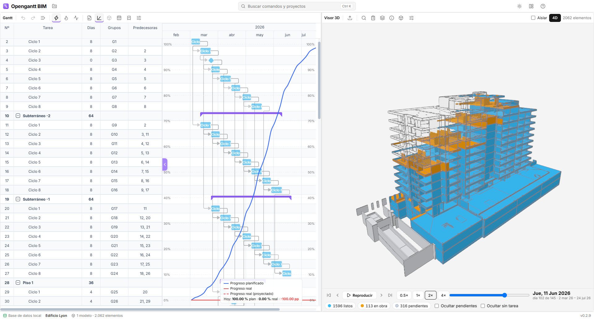

# Opengantt BIM

[Español](README.md) · **English**

Free, open-source (MIT) desktop app for construction scheduling: a Gantt chart, line of balance and **4D simulation** on IFC models. Your projects and models stay on your computer.



## Quick install

On Windows 10 or 11, open **PowerShell** and paste:

```powershell
irm https://raw.githubusercontent.com/gjordanp/opengantt-bim/main/installer/install.ps1 | iex
```

It downloads the latest installer, checks it is not damaged, and runs it. To do it by hand, or to see what Windows says (the installer is not signed yet), see [Install](#install).

## What it does

- **Gantt** with its own scheduling engine: dependencies (FS/SS/FF/SF + lag), project calendar and holidays, auto-schedule, float and critical path, undo/redo, today line.
- **Progress and S-curve**: actual progress per task, baseline and S-curve, also weighted by model volume.
- **Line of balance (LOB)**, with rows scaled by surface.
- **BIM / IFC**: import an IFC, 3D viewer, element search by class, storey or name, **groups** (also generated by Floor × Cycle) and assigning groups to tasks.
- **4D simulation**: plays the schedule on the model, with a legend (done, in progress, pending), speed, date jumps and keyboard shortcuts. The model builds up as the days advance.
- **3D view modes**: solid, lines only and X-ray, with adjustable transparency.
- **Import with AI**: ask ChatGPT or Claude for a schedule using the instructions the app generates, then paste it in.
- **MS Project**: import `.mpp` or XML and export XML. Constraints, resources and costs are not carried over.
- **Workspace** with dockable panels, a command palette (`Ctrl+K`) and light or dark theme.
- **Automatic updates** from the GitHub releases of this repository.

The Community edition of the gantt library ([`dhtmlx-gantt`](https://www.npmjs.com/package/dhtmlx-gantt), MIT) has no auto-scheduling, critical path, undo/redo or task layers. Those are implemented here.

## Install

Requirements: Windows 10 or 11 (64-bit). It is the only supported platform for now.

### Option 1: installer (recommended)

1. Open the [Releases](https://github.com/gjordanp/opengantt-bim/releases/latest) page.
2. Download `Opengantt-BIM-Setup-x.y.z.exe` (about 200 MB).
3. Run it and follow the wizard.

> **Windows warning.** The installer is **not code-signed yet** (the SignPath application is pending). If you download it with a browser, Windows may show "Windows protected your PC". That is expected for unsigned software: choose "More info", then "Run anyway" only if you trust the source. You can check the file by comparing its SHA-512 with the one in the release's `latest.yml`.

### Option 2: one PowerShell command

PowerShell ships with Windows. Paste this in a terminal:

```powershell
irm https://raw.githubusercontent.com/gjordanp/opengantt-bim/main/installer/install.ps1 | iex
```

The script finds the latest release, downloads the installer, **checks its size and SHA-512** against the values published in the release, and only then runs it. A damaged file is deleted and never run. It does not hide or disable any Windows warning, and the installer is still unsigned. To read the script before running it, see [`installer/install.ps1`](installer/install.ps1). Details and options (version, silent mode) are in [`installer/README.md`](installer/README.md).

### Updates

The app checks for a new version on start and every few hours, downloads it in the background, and offers to restart to install it.

## Use it in 5 steps

1. **Project.** In "Proyectos" create a new one, import one from MS Project, or use **Importar con IA…** to generate the schedule.
2. **Tasks and links.** Adjust durations, dependencies and the work calendar (calendar button in the Gantt toolbar).
3. **Model.** In the 3D viewer, import your `.ifc` file.
4. **Groups and assignment.** Create element groups (by search or with **Combinar**, Floor × Cycle) and assign them to tasks, in the "Grupos" column or with "Asignar a…".
5. **Simulate.** Turn on 4D in the viewer and press Play. `Space` plays or pauses, `←` and `→` move one day.

The app is in Spanish; its help panel (`?` icon) has more detail.

## Compared with other tools

| | Opengantt BIM | Navisworks TimeLiner | MS Project |
|---|---|---|---|
| Price | Free, MIT | Paid | Paid |
| 4D simulation on IFC | Yes | Yes | No |
| How the schedule links to the model | Groups assigned to tasks | Sets and rules | Not applicable |
| Scheduling (critical path, calendars) | Yes | Imports from other tools | Yes, more complete |
| Resources and costs | No | Costs in the simulation | Yes |
| Data | Local, on your machine | Local | Local |

This compares scope, not maturity: Navisworks and MS Project are established products with many features this app lacks.

## Limits and roadmap

- Installer is not code-signed for now (see below).
- Windows only.
- No resources or costs. A 5D (cost) simulation is under study: [docs/estudio-5d-bim.pdf](docs/estudio-5d-bim.pdf) (in Spanish).
- Performance with very large IFC files (around 100 MB or more) has not been tested.

## Develop

```bash
npm install
npm run dev          # Electron window with hot reload
npm run dev:web      # renderer only, in a regular browser (http://localhost:5173)
npm run typecheck
npm test
npm run build
npm run dist         # installer (downloads the bundled mongod the first time)
```

Publishing a version is described in [docs/RELEASING.md](docs/RELEASING.md).

## Stack

- Electron + Vite (`electron-vite`) + React + TypeScript
- [`dockview`](https://dockview.dev/) for the dockable workspace
- Data: MongoDB-style documents behind a `ProjectRepository` interface, using a private `mongod` that ships with the app
- BIM: `web-ifc` and the That Open components/fragments

## Privacy

Opengantt BIM does not collect or transmit information about you or your projects. Your projects and IFC models stay on your computer. The only network access is the update check, which asks GitHub whether a newer release of this repository exists and downloads it; no personal data is sent besides what any HTTPS request carries (such as your IP address).

## Code signing policy

Free code signing provided by [SignPath.io](https://signpath.io/), certificate by [SignPath Foundation](https://signpath.org/).

*Signing has not started yet; releases are unsigned until the project is accepted into the SignPath Foundation program.*

Team roles:

- **Author, reviewer and approver:** [Gabriel Jordan](https://github.com/gjordanp)

Releases are built from this repository by the [release workflow](.github/workflows/release.yml) on GitHub-hosted runners, and every signing request is approved manually.

## Licenses of dependencies

`dhtmlx-gantt` Community: MIT. `web-ifc`: MPL-2.0. That Open components/fragments: MIT. `dockview`: MIT. The installer ships an unmodified MongoDB Community Server (SSPL) binary that runs as a separate local process; see [THIRD_PARTY_NOTICES.md](THIRD_PARTY_NOTICES.md).

## License

[MIT](LICENSE)
