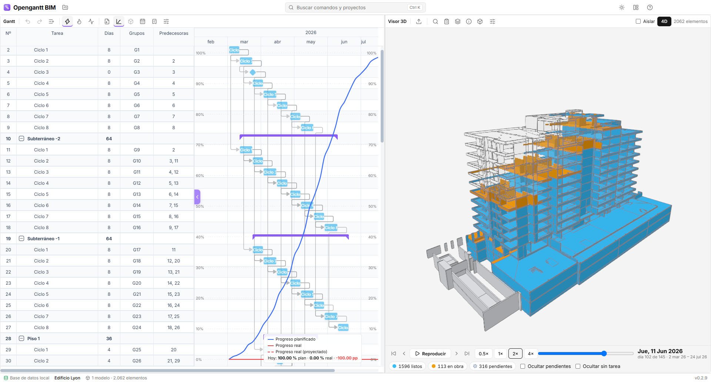

# Opengantt BIM

**Español** · [English](README.en.md)

Aplicación de escritorio gratuita y de código abierto (MIT) para planificar obras: carta Gantt, línea de balance y **simulación 4D** sobre modelos IFC. Tus proyectos y modelos quedan en tu computador.



## Qué hace

- **Gantt** con motor de programación propio: dependencias (FC/CC/FF/CF con desfase), calendario laboral y feriados, programación automática, holguras y ruta crítica, deshacer/rehacer, línea de hoy.
- **Avance y curva S**: avance real por tarea, línea base y curva S, también ponderada por volumen del modelo.
- **Línea de balance (LOB)**, con filas escaladas por superficie.
- **BIM / IFC**: importa un IFC, visor 3D, búsqueda de elementos por clase, nivel o nombre, **grupos** (también generados por Piso × Ciclo) y asignación de grupos a tareas.
- **Simulación 4D**: reproduce el cronograma sobre el modelo, con leyenda (terminado, en construcción, pendiente), velocidad, saltos de fecha y atajos de teclado. El modelo se va construyendo a medida que avanzan los días.
- **Modos de vista 3D**: sólido, solo líneas y rayos X, con transparencia ajustable.
- **Importar con IA**: pide un cronograma a ChatGPT o Claude con las instrucciones que genera la app y pégalo.
- **MS Project**: importa `.mpp` o XML y exporta XML. No se traspasan restricciones, recursos ni costos.
- **Espacio de trabajo** con paneles acoplables, paleta de comandos (`Ctrl+K`) y tema claro u oscuro.
- **Actualizaciones automáticas** desde las releases de este repositorio.

La edición Community de la librería de Gantt ([`dhtmlx-gantt`](https://www.npmjs.com/package/dhtmlx-gantt), MIT) no trae programación automática, ruta crítica, deshacer ni capas de tareas. Eso está implementado aquí.

## Instalación

Requisitos: Windows 10 u 11 (64 bits). Por ahora es la única plataforma soportada.

### Opción 1: instalador (recomendada)

1. Abre la página de [Releases](https://github.com/gjordanp/opengantt-bim/releases/latest).
2. Descarga `Opengantt-BIM-Setup-x.y.z.exe` (unos 200 MB).
3. Ejecútalo y sigue el asistente.

> **Aviso de Windows.** El instalador **aún no está firmado** (la solicitud de firma con SignPath está pendiente). Si lo descargas con el navegador, Windows puede mostrar «Windows protegió su PC». Es esperable en un programa sin firma: elige «Más información» y luego «Ejecutar de todas formas» solo si confías en el origen. Puedes comprobar que el archivo es el publicado comparando su SHA-512 con el de `latest.yml` de la release.

### Opción 2: un comando en PowerShell

PowerShell viene con Windows. Pega esto en una terminal:

```powershell
irm https://raw.githubusercontent.com/gjordanp/opengantt-bim/main/installer/install.ps1 | iex
```

El script busca la última release, descarga el instalador, **verifica su tamaño y su SHA-512** contra los publicados en la release y recién entonces lo ejecuta. Si el archivo está dañado, lo borra y no lo ejecuta. No oculta ni desactiva ninguna advertencia de Windows, y el instalador sigue sin estar firmado. Si prefieres leer el script antes de ejecutarlo, está en [`installer/install.ps1`](installer/install.ps1). Detalles y opciones (versión, modo silencioso) en [`installer/README.md`](installer/README.md).

### Actualizaciones

La app busca una versión nueva al iniciar y cada algunas horas, la descarga en segundo plano y ofrece reiniciar para instalarla.

## Uso en 5 pasos

1. **Proyecto.** En «Proyectos» crea uno nuevo, importa uno de MS Project o usa **Importar con IA…** para generar el cronograma.
2. **Tareas y vínculos.** Ajusta duraciones, dependencias y el calendario laboral (botón del calendario en la barra del Gantt).
3. **Modelo.** En el visor 3D importa tu archivo `.ifc`.
4. **Grupos y asignación.** Crea grupos de elementos (por búsqueda o con **Combinar**, Piso × Ciclo) y asígnalos a las tareas, en la columna «Grupos» o con «Asignar a…».
5. **Simular.** Activa el 4D en el visor y pulsa Reproducir. `Espacio` reproduce o pausa, `←` y `→` mueven un día.

Más detalle en el panel de ayuda de la app (icono `?`).

## Comparación con otras herramientas

| | Opengantt BIM | Navisworks TimeLiner | MS Project |
|---|---|---|---|
| Precio | Gratis, MIT | De pago | De pago |
| Simulación 4D sobre IFC | Sí | Sí | No |
| Cómo se vincula el cronograma al modelo | Grupos asignados a tareas | Conjuntos y reglas | No aplica |
| Programación (ruta crítica, calendarios) | Sí | Importa de otras herramientas | Sí, más completa |
| Recursos y costos | No | Costos en simulación | Sí |
| Datos | Locales en tu equipo | Locales | Locales |

Es una comparación de alcance, no de madurez: Navisworks y MS Project son productos consolidados con muchas funciones que esta app no tiene.

## Límites y hoja de ruta

- Instalador sin firma de código por ahora (ver más abajo).
- Solo Windows.
- Sin recursos ni costos. Una simulación 5D (costos) está en estudio: [docs/estudio-5d-bim.pdf](docs/estudio-5d-bim.pdf).
- Con IFC muy grandes (del orden de 100 MB o más) el rendimiento no se ha probado.

## Desarrollo

```bash
npm install
npm run dev          # ventana de Electron con recarga en caliente
npm run dev:web      # solo el renderer, en un navegador (http://localhost:5173)
npm run typecheck
npm test
npm run build
npm run dist         # instalador (descarga mongod la primera vez)
```

La publicación de versiones está descrita en [docs/RELEASING.md](docs/RELEASING.md).

## Tecnología

- Electron + Vite (`electron-vite`) + React + TypeScript
- [`dockview`](https://dockview.dev/) para el espacio de trabajo acoplable
- Datos: documentos tipo MongoDB tras una interfaz `ProjectRepository`, con un `mongod` privado que viene con la app
- BIM: `web-ifc` y los componentes/fragments de That Open

## Privacidad

Opengantt BIM no recopila ni transmite información sobre ti ni tus proyectos. Tus proyectos y modelos IFC permanecen en tu computador. El único acceso a la red es la búsqueda de actualizaciones, que consulta a GitHub si existe una versión nueva de este repositorio y la descarga; no se envían datos personales más allá de lo que lleva cualquier solicitud HTTPS (por ejemplo, tu dirección IP).

## Política de firma de código

Firma gratuita proporcionada por [SignPath.io](https://signpath.io/), certificado de [SignPath Foundation](https://signpath.org/).

*La firma aún no ha comenzado; las releases no están firmadas hasta que el proyecto sea aceptado en el programa de SignPath Foundation.*

Roles del equipo:

- **Autor, revisor y aprobador:** [Gabriel Jordan](https://github.com/gjordanp)

Las releases se construyen desde este repositorio con el [workflow de release](.github/workflows/release.yml) en runners de GitHub, y cada solicitud de firma se aprueba manualmente.

## Licencias de dependencias

`dhtmlx-gantt` Community: MIT. `web-ifc`: MPL-2.0. Componentes/fragments de That Open: MIT. `dockview`: MIT. El instalador incluye sin modificar un binario de MongoDB Community Server (SSPL) que corre como proceso local separado; ver [THIRD_PARTY_NOTICES.md](THIRD_PARTY_NOTICES.md).

## Licencia

[MIT](LICENSE)
